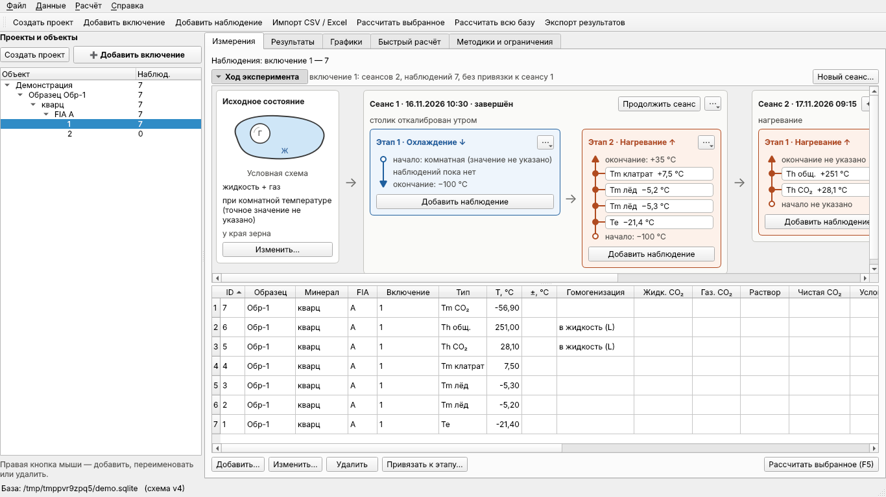
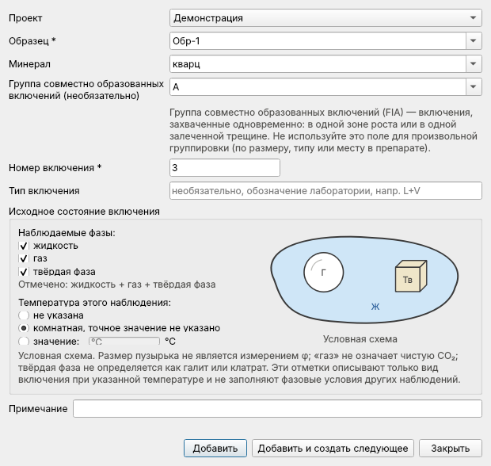

# Ход эксперимента: включения, сеансы и этапы (FluidCalc 0.6.0)

Интерфейсная доработка. Расчётные модели, паспорта и результаты не изменены: сведения о сеансах, этапах и
исходном состоянии включения расчётами **не используются**.

## Краткая инструкция

1. **«Создать проект»** (над деревом, один раз), затем **«➕ Добавить включение»** (Ctrl+Shift+N).
   В одном окне: образец и минерал — выбрать из списка или ввести новое имя; группа совместно образованных
   включений (FIA) — необязательно; номер — предложен следующий свободный; наблюдаемые фазы (жидкость, газ,
   твёрдая фаза; ничего не отмечено — «не указано»); температура этого наблюдения — «не указана», «комнатная,
   точное значение не указано» или число; примечание. «Добавить и создать следующее» оставляет образец,
   минерал и группу. Узлы дерева создаются сами; занятый номер включения отклоняется.
2. Выберите включение в дереве. Над таблицей измерений — панель **«Ход эксперимента»**.
   «Новый сеанс…» — дата и время опыта (можно исправить позже или отметить «не указана») и примечание.
3. В сеансе нажмите **«+ Охлаждение»** или **«+ Нагревание»**; начальная и конечная температуры — только
   если известны (окончание можно заполнить позже через «⋯ → Изменить этап»).
4. На карточке этапа — **«Добавить наблюдение»**: открывается обычный диалог наблюдения. Отметка появляется
   на температурной линии этапа и строкой в таблице — это одна и та же запись. Щелчок по отметке — правка;
   правая кнопка — привязать к другому этапу, снять привязку, удалить.
5. **«Завершить сеанс»** — когда работа на сегодня окончена. В другой день: «Новый сеанс…» (или «Продолжить
   сеанс» у прежнего). Всё сохраняется в базе сразу, отдельной кнопки сохранения нет.
6. Старые и импортированные наблюдения показаны карточкой **«Без привязки к сеансу»**; привязать их можно
   вручную («Привязать к этапу…» на карточке или под таблицей). Таблицей и импортом можно пользоваться и без
   сеансов.

## Что означает схема

* Рисунок включения — **условная схема**: размер пузырька не является измерением φ; «газ» не означает чистую
  CO₂; твёрдая фаза не определяется как галит или клатрат. Отметки фаз не заполняют фазовые условия наблюдений
  (жидкая/газовая CO₂ при плавлении клатрата, пар при растворении галита и т. д.) — они вводятся, как и
  прежде, в диалоге наблюдения.
* Температурная линия этапа: теплее — выше, холоднее — ниже; стрелка — направление этапа. Отметки упорядочены
  по температуре, расстояния между ними условные. Обязательной последовательности переходов нет.
* Повторные измерения одного перехода и повторные циклы (несколько этапов охлаждения и нагревания) допускаются.
  Если расчёт не принимает несколько значений, действует прежнее сообщение расчёта: программа не усредняет и не
  выбирает.
* Ничего не подставляется: неизвестная комнатная температура остаётся «комнатная, точное значение не указано»
  (не 20 °C); переходы между этапами и сеансами не достраиваются; дата опыта хранится отдельно от даты ввода.

## Хранение и перенос

* Схема базы v4 (миграция автоматическая, с резервной копией `*.bak-v3-дата.sqlite`): таблицы `sessions`
  (включение, дата опыта, примечание, признак завершения, дата ввода) и `stages` (сеанс, номер, направление,
  начало, признак «комнатная», окончание, примечание); у наблюдения — необязательная ссылка `stage_id`;
  у включения — исходное состояние (`initial_*`). Удаление этапа или сеанса наблюдения не удаляет: они
  становятся «без привязки».
* «Экспорт таблицы измерений (CSV)» добавляет к каждой строке столбцы сеанса, этапа и исходного состояния;
  импорт этого файла восстанавливает сеансы и этапы без дубликатов. Этапы и сеансы **без наблюдений** в таблицу
  измерений не попадают — они сохраняются в копии базы (`.sqlite`) и в «Выгрузить всю базу в XLSX» (листы
  `sessions`, `stages`).
* Экспорт результатов расчёта и лабораторная сводная таблица не изменены.

## Что проверено

Автоматически (`tests/test_experiment.py`, Qt без экрана): миграция базы v3 с сохранением наблюдений и
результатов; диалог включения (новые и существующие узлы, отказ при занятом номере, «создать следующее»);
сеанс охлаждения → закрытие окна → повторное открытие базы → сеанс нагревания другим днём; совпадение записей
панели и таблицы при добавлении, правке и удалении с обеих сторон; повторные наблюдения; неизвестные
температуры и даты; независимость расчёта от привязки к этапам; экспорт/импорт со сведениями о сеансах.

Требует просмотра на рабочих машинах (Windows и OSNova): внешний вид и читаемость при системном шрифте и
масштабе экрана, поведение границы панели при перетаскивании мышью, календарь выбора даты, контекстные меню по
правой кнопке, работа с реальной (не тестовой) базой после миграции.
