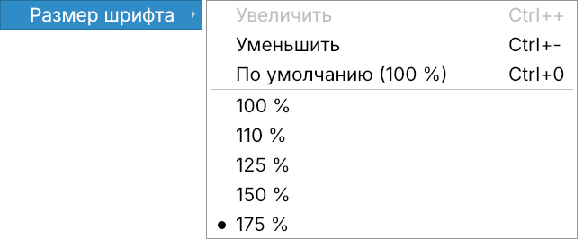
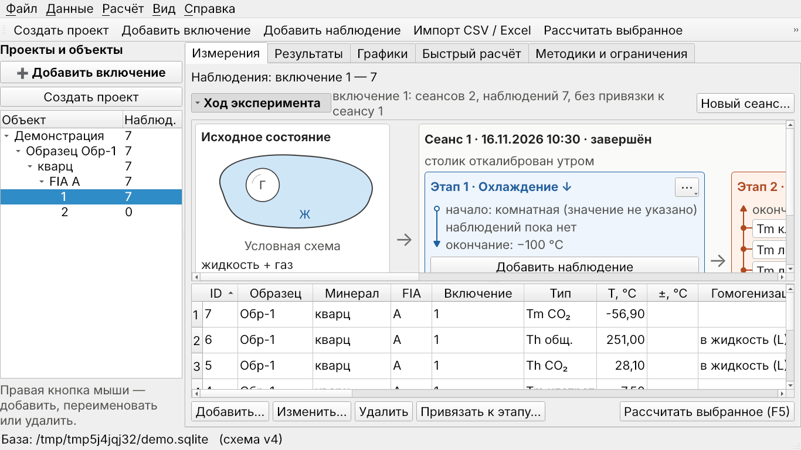

# Размер шрифта (FluidCalc 0.6.1)

Меню **«Вид → Размер шрифта»**: «Увеличить» (Ctrl++ или Ctrl+=), «Уменьшить» (Ctrl+−), «По умолчанию (100 %)»
(Ctrl+0) и выбор масштаба 100, 110, 125, 150, 175 % (шаг 10–25 %). Масштаб отсчитывается от системного шрифта
(Windows, KDE) и сохраняется в `QSettings` (ключ `font_scale`: на Windows — реестр
`HKEY_CURRENT_USER\Software\FluidCalc\FluidCalc`, на Linux — `~/.config/FluidCalc/FluidCalc.conf`).
Испорченное значение в настройках заменяется ближайшим допустимым (нечисловое — 100 %).

## Как устроено (`fluid_app/gui/fontscale.py`)

* Масштабируется шрифт приложения по умолчанию и шрифты классов, которые платформа задаёт отдельно (меню,
  строка меню, окна сообщений, подсказки, строка состояния, кнопки, заголовки таблиц и др.); иначе на Windows
  меню и окна сообщений остались бы прежнего размера.
* Высота строк таблиц пересчитывается по шрифту, в том числе у таблиц, создаваемых позже (диалог импорта):
  Qt сам её не меняет, и крупный текст обрезался бы.
* Фиксированные ширины (карточки панели «Ход эксперимента», поля температуры, левая часть «Быстрого расчёта»)
  умножаются на масштаб.
* Вкладки главного окна и длинные диалоги («Добавить включение», «Наблюдение») прокручиваются, если не
  помещаются: кнопки «Сохранить»/«Добавить» остаются видны, окно не выходит за пределы экрана.
* Кнопки «Добавить включение» и «Создать проект» стоят одна под другой, чтобы левая панель не расширялась.

## Проверка

Автоматически (`tests/test_ui_settings.py`, Qt без экрана): применение масштаба к общему шрифту и шрифтам
классов, к подсказкам, дереву, строке меню и высоте строк таблиц; диалоги, открытые после смены масштаба;
сохранение и восстановление после «перезапуска» (новое главное окно читает `QSettings`); «По умолчанию»;
границы 100–175 % и шаги; рост фиксированных размеров; диалог включения не выше и не шире экрана.
Вручную в контейнере просмотрены снимки 100 % и 175 % на виртуальном экране 1366×768.

Требует просмотра на Windows 11 и OSNova (KDE): реальные системные шрифты и масштаб экрана Windows (125–150 %)
вместе с масштабом программы, меню и подсказки в нативном стиле, сочетания клавиш Ctrl++ / Ctrl+− на разных
раскладках клавиатуры.
